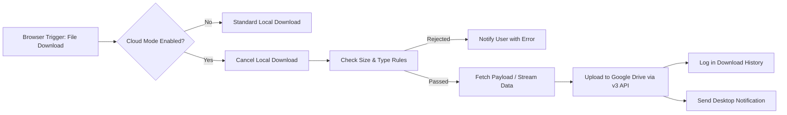

# ☁️ CloudDrop

> Seamlessly intercept, route, and save browser downloads directly to Google Drive — eliminating local clutter and keeping your files organized in the cloud.

[](#)
[](#)
[](#)
[](LICENSE)
[](#contributing)

---

## 📌 Overview

**CloudDrop** is a modern Chromium extension (Manifest V3) that intelligently redirects web downloads straight to your Google Drive account. Instead of filling up your local storage with downloads and manually re-uploading them later, CloudDrop handles the transfer automatically in the background with full folder management, quota tracking, and real-time desktop notifications.

---

## ✨ Features

- **⚡ Cloud Mode Automation**: One-click toggle to automatically intercept browser downloads and route them directly to Google Drive.
- **📁 Interactive Folder Management**:
  - Browse your Google Drive directory tree directly from the extension popup.
  - Create new destination folders on the fly without leaving your current tab.
  - Select root or any nested subfolder as the target destination.
- **📊 Real-time Storage Quota Tracker**: Visual storage meter showing live used and total storage on your Google Drive account.
- **🛡️ Custom File Restrictions**:
  - Filter downloads by file type (All files, Documents, Images, Videos, Archives).
  - Set custom file size thresholds (e.g., maximum 100 MB) to prevent accidental large transfers.
- **📜 Download History Log**: Keep track of synced files, timestamps, sizes, and Google Drive file IDs with easy clear actions.
- **🔔 Native Desktop Notifications**: Instant system notifications for transfer initiation, success with Drive file path, and error handling.
- **🔐 Secure OAuth 2.0**: Built on Google Identity Services with official Google Drive V3 APIs and scoped permissions.
- **🎨 Modern Dark UI**: Sleek, glassmorphic dark interface designed for readability and speed.

---

## 🏗️ Architecture & Workflow



---

## 🚀 Installation & Setup

### Prerequisites
- Google Chrome, Microsoft Edge, Brave, or any Chromium-based browser.
- A Google account.

### Step 1: Clone or Download the Repository
```bash
git clone https://github.com/pk1519/CloudDrop.git
```
*(Or extract the ZIP package to a local directory)*

### Step 2: Load into Chrome
1. Open Google Chrome and enter `chrome://extensions` in the address bar.
2. Toggle on **Developer mode** in the top-right corner.
3. Click the **Load unpacked** button in the top-left corner.
4. Select the project folder:
   ```text
   path/to/CloudDrop
   ```
5. Pin **CloudDrop** to your browser toolbar for quick access.

---

## ⚙️ Google Cloud Console Configuration (OAuth 2.0)

To connect the extension to your Google Drive account via Chrome Identity API:

1. Go to the [Google Cloud Console](https://console.cloud.google.com/).
2. Create a new project (e.g., `Drive-Download-Manager`).
3. Enable the **Google Drive API**:
   - Navigate to **APIs & Services > Library**.
   - Search for **Google Drive API** and click **Enable**.
4. Configure the **OAuth Consent Screen**:
   - Select **External** (or **Internal** for Workspace users).
   - Add test users (your Google account email).
   - Add the required scopes:
     - `https://www.googleapis.com/auth/drive.file`
     - `https://www.googleapis.com/auth/drive`
5. Create **OAuth 2.0 Client Credentials**:
   - Go to **APIs & Services > Credentials > Create Credentials > OAuth client ID**.
   - Select **Chrome extension** as the application type.
   - Enter your Extension ID (found at `chrome://extensions` under your loaded extension).
6. Update [`manifest.json`](manifest.json):
   ```json
   "oauth2": {
     "client_id": "YOUR_CLIENT_ID.apps.googleusercontent.com",
     "scopes": [
       "https://www.googleapis.com/auth/drive.file",
       "https://www.googleapis.com/auth/drive"
     ]
   }
   ```
7. Click **Reload** on the extension card in `chrome://extensions`.

---

## 📂 Project Structure

```text
├── manifest.json        # Extension manifest (Manifest V3, permissions, OAuth2)
├── background.js        # Background service worker (intercepts downloads, Drive API)
├── popup.html           # Main popup UI layout
├── popup.css            # Styling & design system (glassmorphism dark theme)
├── popup.js             # UI controller, event handlers, and messaging bridge
├── icons/               # Extension icons (16px, 32px, 48px, 128px)
└── README.md            # Project documentation
```

---

## 🔒 Permissions & Security

| Permission | Purpose |
| :--- | :--- |
| `downloads` | Detects initiated downloads and intercepts them when Cloud Mode is active. |
| `storage` | Stores user preferences, target folder IDs, and local download history. |
| `notifications` | Displays native OS notifications for progress and upload completions. |
| `identity` | Handles secure Google OAuth 2.0 authentication flow. |
| `activeTab` | Contextual access when interacting through the extension popup. |

---

## 💡 Troubleshooting

- **"OAuth2 not granted" or login window fails to open**:
  Ensure the Extension ID shown in `chrome://extensions` is registered under your OAuth Client ID in the Google Cloud Console.
- **CORS error on certain file downloads**:
  The extension contains an automated fallback mechanism that streams through the Chrome Downloads API if a site blocks direct cross-origin fetches.
- **File not appearing in target folder**:
  Verify the selected destination in the popup; if the target folder was deleted from Google Drive, switch back to `Root` or re-select an existing folder.

---

## 🤝 Contributing

Contributions, issues, and feature requests are welcome!

1. Fork the project.
2. Create your feature branch (`git checkout -b feature/NewFeature`).
3. Commit your changes (`git commit -m 'Add NewFeature'`).
4. Push to the branch (`git push origin feature/NewFeature`).
5. Open a Pull Request.

---

## 📄 License

This project is licensed under the [MIT License](LICENSE).
